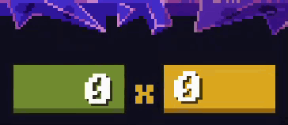
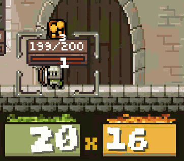

# PeglinBalatroScore

Watch every shot add up, Balatro style. A **pegs x damage** score sits above the enemy scroll in battle, counts up as
your orb bounces, and catches fire when the shot gets big.

## Features

- **Pegs x damage, live.** The green box is what the pegs you've hit are worth (relics that make a hit worth more count). The yellow box is your orb's damage per peg, jumping to its crit damage when you trigger a crit. Every increase lands with a jolt.
- **The real total.** When the balls stop, the boxes give way to the damage the game actually deals, bonuses and multipliers included, for 3 seconds (real time, so game speed doesn't cut it short), then it fades out. Fire again and you're straight back to `0 x 0`.
- **Flames.** The closer a shot gets to the act boss's max HP, the bigger the fire, and it bursts when you pass it.
- **OVERKILL!** A burning stamp when a shot beats the boss's max HP, or a green **OVERHEAL!** when a heal goes past yours.
- **Hover for help.** Mouse over the score for a plain explanation and your last shot's damage or healing.
- **Fits the game's UI.** Tooltips draw over the score, and in boss fights the boss health bar and enemy scroll slide down to make room.

## Installation

**With a mod manager (recommended):** install PeglinBalatroScore from Thunderstore with r2modman or the Thunderstore
Mod Manager. BepInEx is installed for you.

**Manually:** install [BepInExPack_Peglin](https://thunderstore.io/c/peglin/p/BepInEx/BepInExPack_Peglin/), then put
`PeglinBalatroScore.dll` in `Peglin/BepInEx/plugins/`.

Built for Peglin v2.0.12. Works alongside
[PeglinRelicRerolls](https://thunderstore.io/c/peglin/p/PierreMarais/PeglinRelicRerolls/) and
[PeglinMaxSpeed](https://thunderstore.io/c/peglin/p/PierreMarais/PeglinMaxSpeed/).

## Settings

In `BepInEx/config/PeglinBalatroScore.cfg` (start the game once to create it):

| Setting | Default | What it does |
|---|---|---|
| `ShowScore` | true | Show the score in battles |
| `ResultSeconds` | 3 | How long the final total stays up, in real seconds |
| `ShowFlames` | true | Flames behind the score |
| `ShakeNumbers` | true | Numbers shake as the score heats up |
| `ShowOverkill` | true | OVERKILL / OVERHEAL stamp |
| `Scale`, `OffsetX`, `OffsetY` | 1, 0, 0 | Size and position nudges |
| `EnableLogging` | true | Boss HP target and layout notes in `BepInEx/LogOutput.log` |

## Building

See [BUILDING.md](BUILDING.md).
