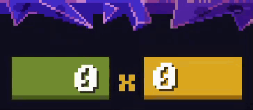
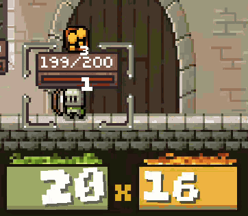
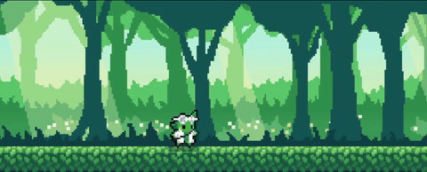

# PeglinBalatroScore

Watch every shot add up, Balatro style. A **pegs × damage** score counts up as your orb bounces and catches fire as the shot closes in on the boss's HP, and a bomb chest behind Peglin pays out every bomb you set off.







## Features

- **Pegs × damage, live.** The green box is what the pegs you've hit are worth (relics that make a hit worth more count). The yellow box is your orb's damage per peg, jumping to its crit damage when you trigger a crit, and every increase lands with a jolt.
- **The real total.** When the balls stop, the boxes give way to the damage the game actually deals, bonuses and multipliers included (even the ones added as Peglin attacks, like Echo), for **3 seconds** of real time (game speed doesn't cut it short). Fire again and you're straight back to `0 × 0`.
- **Flames.** The closer a shot gets to the act boss's max HP, the bigger the fire, and it bursts when you pass it. The target follows the boss's real HP, Cruciball included.
- **OVERKILL!** A burning stamp when a shot beats the boss's max HP, or a green **OVERHEAL!** when a heal goes past yours.
- **Bomb chest.** A see-through chest behind Peglin catches a bomb the moment each one is lit, while your orb is still bouncing. It's sized for **10 bombs**; extra ones heap up and spill over the sides.
- **The bomb payout.** The instant Peglin's last thrown bomb explodes, the chest goes off with it: every bomb inside explodes, the chest blows apart into planks, and the bombs' total damage (each bomb counted once, after relics) bursts out of the wreckage, then shatters.
- **Fonts.** The score and the bomb chest's total draw in the game's own font, or whatever font PeglinFonts is using, hotkey changes included.
- **Hover for help.** Mouse over the score for a plain explanation and your last shot's damage or healing.
- **Fits the game's UI.** Tooltips draw over the score, and in boss fights the boss health bar and enemy scroll slide down to make room.

## For mod authors

Other mods can work with the score through `BalatroScoreApi`, found by its simple type name, so you need no reference to this plugin. Add `[BepInDependency("PeglinBalatroScore", BepInDependency.DependencyFlags.SoftDependency)]` to your plugin so it loads after this one; otherwise the lookup below finds nothing when your `Awake` runs first.

```csharp
using System;
using System.Linq;
using BepInEx.Bootstrap;

static void RegisterScoreTarget(string myGuid, Func<long> currentBossMaxHp)
{
    if (!Chainloader.PluginInfos.TryGetValue("PeglinBalatroScore", out var info) || info.Instance == null) return;
    Type api = info.Instance.GetType().Assembly.GetTypes().FirstOrDefault(t => t.Name == "BalatroScoreApi");
    var version = api?.GetProperty("ApiVersion")?.GetValue(null) as int?;
    if (version == null || version < 1) return;
    api.GetMethod("SetTargetProvider")?.Invoke(null, new object[] { myGuid, currentBossMaxHp });
}
```

- `ApiVersion` is `1`.
- `SetTargetProvider(string guid, Func<long> provider)` sets the HP the flames and OVERKILL aim at, asked at the start of every damaging shot. A value above 0 is used exactly as given (lower than the boss's normal HP is fine); 0 or less means no opinion. The first mod with an opinion, in registration order, wins. Healing shots always aim at the player's max HP.
- `SetHudSuppressor(string guid, Func<string, bool> suppress)` hides parts of the HUD. It is asked often (up to every frame; don't rely on when) for each part by name: `"score"` (the score, with its OVERKILL stamp), `"overkill"` (only the OVERKILL/OVERHEAL stamp) and `"bomb_chest"` (the bomb chest; one in progress is dropped without its burst and stays gone until that turn's bombs are all thrown). True from any mod hides that part. New parts may be added, so return false for names you don't know unless you mean to hide everything. Scoring and listeners carry on while hidden. Keep it cheap.
- `SetScoreListener(string guid, Action<string, long, long> listener)` is told once for each scored result, after its final total is known: the kind, the total and the target it was measured against. Kinds are `"shot"` (a damaging shot: the damage the attack goes out with, told as the attack goes out, or when the next shot is fired or the battle ends if there is no attack), `"heal"` (a healing shot; the target is the player's max HP) and `"bombs"` (Peglin's thrown bombs for a turn: each bomb's damage after relics, counted once however many enemies it hits, told when the next shot is fired or the battle ends; the target is the latest damaging shot's). New kinds may be added, so ignore ones you don't know. It is told whether or not the HUD is showing; a shot is not told if the battle disappears while it is in play (quitting to the menu).
- `CurrentTarget` is the target the score is using, as of the latest shot.
- `RemoveAll(string guid)` removes everything your GUID registered.
- Every member follows the same rules: registering again with the same GUID replaces the old callback, a null callback removes it, and a null or empty GUID is ignored. A callback that throws is logged once and ignored.

## Installation

**With a mod manager (recommended):**
1. Install r2modman or the Thunderstore Mod Manager.
2. Search for PeglinBalatroScore and install it. BepInEx is installed for you.
3. Launch Peglin.

**Manually:**
1. Install [BepInExPack_Peglin](https://thunderstore.io/c/peglin/p/BepInEx/BepInExPack_Peglin/).
2. Put `PeglinBalatroScore.dll` in `Peglin/BepInEx/plugins/`.
3. Start the game once to create the config file.

## Settings

Change these in `BepInEx/config/PeglinBalatroScore.cfg` (start the game once to create it). Restart the game after changing them.

| Setting | Default | What it does |
|---|---|---|
| `ShowScore` | true | Show the score above the enemy scroll in battles |
| `ResultSeconds` | 3 | How long the final total stays up, in real seconds (0.5 to 10) |
| `EnableLogging` | true | Write the boss HP target and layout notes to `BepInEx/LogOutput.log` |
| `ShowFlames` | true | Flames behind the score as it closes in on the boss's HP |
| `ShakeNumbers` | true | The numbers shake harder as the score heats up |
| `ShowOverkill` | true | The OVERKILL / OVERHEAL stamp |
| `Scale` | 1 | Size of the score (0.5 to 2) |
| `OffsetX` | 0 | Move the score left (negative) or right (positive), in pixels at 1920×1080 |
| `OffsetY` | 0 | Move the score down (negative) or up (positive), in pixels at 1920×1080 |
| `ShowBombChest` | true | The bomb chest behind Peglin |
| `ChestScale` | 1 | Size of the chest relative to Peglin (0.5 to 2) |

## Compatibility

- Built for **Peglin v2.0.12**. On other versions the mod writes a warning to the log, as some features may not work.
- Requires [BepInExPack_Peglin](https://thunderstore.io/c/peglin/p/BepInEx/BepInExPack_Peglin/).
- Works alongside [PeglinFonts](https://thunderstore.io/c/peglin/p/PierreMarais/PeglinFonts/), [PeglinMaxSpeed](https://thunderstore.io/c/peglin/p/PierreMarais/PeglinMaxSpeed/) and [PeglinRelicRerolls](https://thunderstore.io/c/peglin/p/PierreMarais/PeglinRelicRerolls/).

## Good to know

- **The target is the act's boss in every fight of the act**, not the enemies in front of you, so early shots rarely get big flames. Flames light at 5% of the boss's HP on an act's first floor and at 10% from the second. Where there is no map to read the boss from, the toughest enemy on screen is the target.
- **In the Mole fight the target is the tree's HP**, the toughest thing on the field.
- **The bomb total counts Peglin's thrown bombs**, each once however many enemies it hits. Turn the chest off with `ShowBombChest` and the bombs still go off as normal; only the chest is gone.
- **Your save is untouched.** The mod writes only its own config file, and its shaking numbers never use the game's random rolls, so a seed plays out the same with or without it.

## Some of my other mods

- [PeglinFonts](https://thunderstore.io/c/peglin/p/PierreMarais/PeglinFonts/) — change the font of every text in the game.
- [PeglinKeybinds](https://thunderstore.io/c/peglin/p/PierreMarais/PeglinKeybinds/) — rebind keyboard and controller controls from inside the game.
- [PeglinMaxSpeed](https://thunderstore.io/c/peglin/p/PierreMarais/PeglinMaxSpeed/) — play at up to 15× speed without physics bugs.
- [PeglinQuickRestart](https://thunderstore.io/c/peglin/p/PierreMarais/PeglinQuickRestart/) — hold a button to restart your run.
- [PeglinRelicRerolls](https://thunderstore.io/c/peglin/p/PierreMarais/PeglinRelicRerolls/) — reroll the relics you're offered.

[Check out all my Peglin mods](https://old.thunderstore.io/c/peglin/p/PierreMarais/)

### [Please consider buying me a coffee ☕](https://ko-fi.com/pierremarais)
